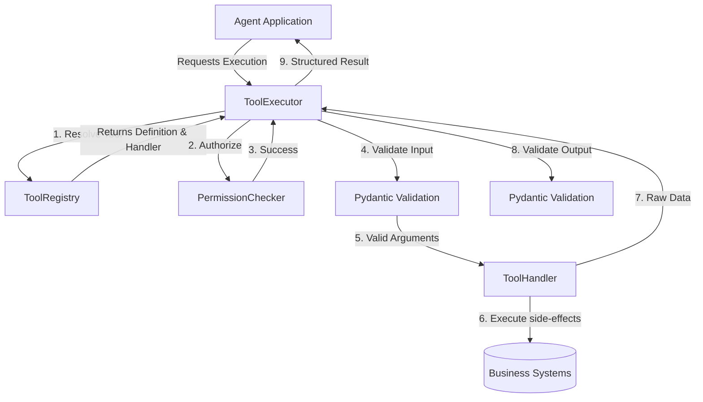

# Architecture: Tool Runtime

The Tool Runtime separates business logic (tools) from authorization and generic argument validation.

## Security Boundaries
1. **Identity & Tenant:** Tool arguments cannot override identity context. Identity is injected independently into the executor.
2. **Schema:** Inputs strictly bound to models. Unexpected arguments discarded or explicitly rejected.
3. **Registry:** LLM arbitrary function generation is impossible because LLMs simply pass a `tool_name` string, which the Registry resolves to an explicitly loaded callable.
